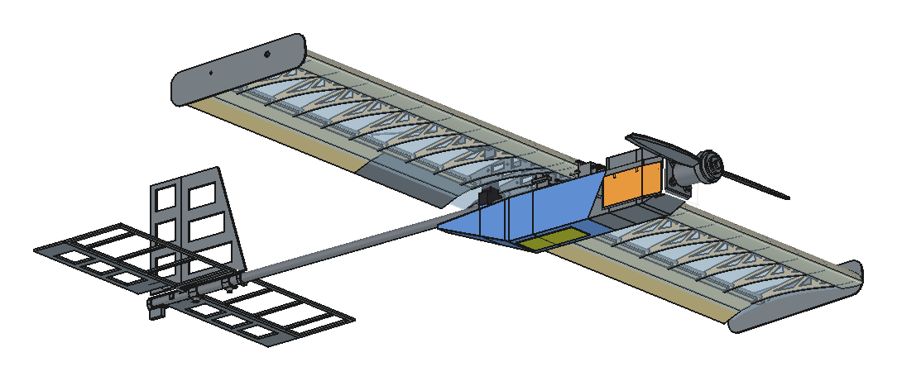
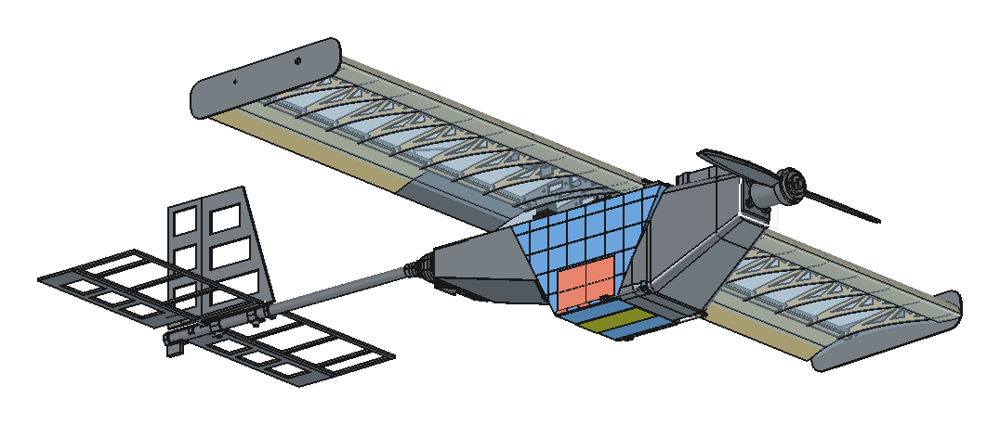

# Techfest 2026 aeromodelling: golf-ball payload RC plane

Design files for an entry in the IIT Bombay Techfest 2026-27 National Aeromodelling competition: a hand-launched, belly-landing electric plane that carries 43 mm golf balls internally and loads and drops them from the transmitter.

There are two versions of the airframe:

| Version | What it is | Empty mass | Build files |
|---|---|---|---|
| **Rev J** | Plain flyer: normal fuselage, no cargo system, 4 servos | 703 g | [design/cad/release_revJ/](design/cad/release_revJ/) |
| **Rev H** | Competition version: ball hopper, side gates, load chute, 6 servos | 807 g | [design/cad/release_revH/](design/cad/release_revH/) |

Both share the same wing, tail, spine, nose pod and wing clamps. [design/08_revJ_plain_fuselage.md](design/08_revJ_plain_fuselage.md) lists the differences.



Rev H for comparison:



## The aircraft (rev H numbers; rev J differs only in the fuselage)

| | Value | Rule limit |
|---|---|---|
| Span (with tip plates) | 1192 mm | 1200 mm |
| Empty mass (from CAD volumes) | 807 g | 1000 g |
| Empty CG | X 233.6 mm from the nose datum | — |
| Wing | rectangular, S1223, chord 240 mm | — |
| Propeller | 13 in folding | 13 in |
| Length | 1018 mm | — |

How it is built:

- **Carbon tubes carry the long loads.** One 14/12 mm spine tube runs nose to tail. The wing has an 8/6 mm front spar and a 4 mm rear spar.
- **The wing and tail are laser-cut balsa.** 18 balsa ribs and 4 lite-ply root ribs slide onto the spars, with a balsa D-box leading edge, trailing-edge strip, ailerons and tip plates. Stab, fin, elevators and rudder are framed 3 mm balsa.
- **The fuselage is three thin printed shells** in foamed LW-PLA: the nose pod (battery, ESC, receiver, motor), the hopper (the V-shaped ball bay with two side gates) and the chute (load port behind the wing). A nose fairing and a tail cone smooth the outside.
- **Printed nodes join the tubes.** Two wing clamp caps, the motor mount and the tail mount are PA-CF; servo trays, brackets and horns are PETG. Every bolted joint is an M3 screw into a brass heat-set insert.

## Where things are

| Path | What |
|---|---|
| [design/cad/TechfestPlane_revJ.FCStd](design/cad/TechfestPlane_revJ.FCStd) | Rev J FreeCAD model (plain fuselage) |
| [design/cad/TechfestPlane_revH.FCStd](design/cad/TechfestPlane_revH.FCStd) | Rev H FreeCAD 1.1 model: 72 parametric bodies driven by one `Params` spreadsheet, assembled with joints |
| [design/cad/release_revH/](design/cad/release_revH/) | **Files to build from**: print, laser and cut files, BOM, renders. Start with its [README](design/cad/release_revH/README.md) |
| [design/cad/laser_dxf/](design/cad/laser_dxf/) | 4 nested laser sheets (balsa 1.5 / 2 / 3 mm, lite-ply 3 mm) |
| [design/cad/assembly_order_revH.md](design/cad/assembly_order_revH.md) | Assembly sequence with tool access checked per bolt |
| [design/01_requirements_and_concept.md](design/01_requirements_and_concept.md) … [07_aero_dfm_review.md](design/07_aero_dfm_review.md) | Requirements, sizing, layout decisions, aero and manufacturing review |
| [design/logs/DESIGN_LOG.md](design/logs/DESIGN_LOG.md) | Phase-by-phase record of decisions, problems and fixes |
| [design/calc/](design/calc/) | Sizing, drag build-up and planform scripts |
| [design/cad/to/](design/cad/to/) | Topology-optimisation scripts and result pictures (front wing clamp, motor mount) |

Older revisions (B to G) are kept in `design/cad/` for reference.

## Regenerating the release

```bash
REV=J freecadcmd design/cad/scripts/export_release.py
```

```bash
REV=J freecadcmd design/cad/scripts/contact_scan.py
```

Use `REV=H` for the cargo version. The first rewrites every file in `release_revJ/` (or `release_revH/`) from the FreeCAD model. The second checks that every part touches the structure, and lists any clashes.

## Status and open items

Done: full airframe modelled and assembled, no floating parts, no clashes above 4 mm³, all printed parts fit a 325 × 320 × 325 mm bed.

Still open:

- **Rev J's assembly solver reports an error** although every part is in place; see the rev J document.
- **Rev J carries no payload**, so only rev H can score in the payload rounds.
- **Electronics are placeholders.** Motor, ESC, battery and servo masses are typical values; the team's actual parts are not yet confirmed.
- **Topology optimisation was stopped after two parts** (front wing clamp −45 %, motor mount −36 %) because it was taking too long. The tail mount and rear clamp keep their hand-lightened shapes.
- **Nothing has been printed or flown.** The 0.4 mm nose fairing skin should be test-printed first.
- The elevators overlap the stab by 3.8 mm³ at the hinge line; bevel on assembly.
- The leading-edge sheets are 1188 mm long, so each needs a scarf joint from two balsa sheets.

The rulebook PDF and reference video are not in this repository; get the rulebook from the Techfest site.
