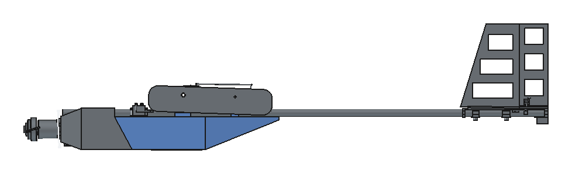

# Rev J manufacturing release (plain fuselage)

Everything here is generated from `../TechfestPlane_revJ.FCStd` by `../scripts/export_release.py`. Do not edit these files by hand; change the model and re-run the script.

## Folders

| Folder | Contents | How to use |
|---|---|---|
| `printed/` | One `.stl` and one `.step` per printed part (12 different parts) | Slice the STL. Orientation, supports and wall settings per part are in [../print_orientation_revJ.csv](../print_orientation_revJ.csv) |
| `laser/` | One `.step` per laser-cut part, for reference | Cut from the nested sheets in [../laser_dxf/](../laser_dxf/), not from these |
| `carbon/cut_list.csv` | Lengths and stock sizes for carbon tubes, rods and the skid | Cut to length; drill the spine as listed in [../assembly_order_revJ.md](../assembly_order_revJ.md) step 0 |
| `assembly/` | Whole aircraft as one STEP, every part in flight position | Open in any CAD tool to check fits |
| `renders/` | Side, top, front and two isometric views | |
| `BOM_revJ_release.csv` | Every part with quantity, material and mass | |
| `release_report.txt`, `contact_scan.txt` | Check results from the last export | |

## The parts, by how they are made

### 3D printed

| Group | Parts | Material |
|---|---|---|
| Nose | `NosePod`, `BatteryHatch` | LW-PLA (foamed) |
| Fuselage | `Fuselage` | LW-PLA (foamed) |
| Loaded nodes | `WingClampCap_F`, `WingClampCap_R`, `MotorMount`, `TailMount` | PA-CF |
| Small fittings | `BatteryTray`, `ServoTray_Ail` ×2, `ServoMount_Spine` ×2, `ControlHorn` ×3, `ControlHorn_Rud` | PETG |

All fit a 325 × 320 × 325 mm bed in one piece. The largest is the fuselage at 320 × 72 × 60 mm, which leaves only 5 mm on a 325 mm bed axis; place it diagonally if it does not fit.

### Laser cut

| Parts | Stock |
|---|---|
| `Rib` ×18, `TipPlate` ×2 | balsa 2 mm |
| `Stab`, `Fin`, `Elevator_L/R`, `Rudder`, `Aileron_L/R`, `TE_Fixed_L/R`, `TE_Strip` | balsa 3 mm |
| `LE_Sheet_Top`, `LE_Sheet_Bot` | balsa 1.5 mm (bent over the ribs; scarf-join two sheets to reach 1188 mm) |
| `RootRib` ×4, rib jig | lite-ply 3 mm |

### Cut from stock

| Part | Stock | Length |
|---|---|---|
| `Spine` | carbon tube 14/12 mm | 943 mm |
| `Spar_Front` | carbon tube 8/6 mm | 1190 mm |
| `Spar_Rear` | carbon rod 4 mm | 1190 mm |
| `Pushrod_Ele`, `Pushrod_Rud` | carbon rod 2 mm, run inside the spine | 733 / 744 mm |
| `Pushrod_AilL/R` | carbon rod 2 mm | 109 mm |
| `BellySkid` | polycarbonate 1 mm | 98 × 40 mm |

### Bought

Motor (35 mm class), 13 in folding prop, ESC, 3S battery, receiver, 4 × 9 g servos, M3 screws and 17 brass heat-set inserts, M2 servo screws, covering film, steel wire for Z-bends. Quantities are in the BOM.

## Checks from the last export

| Check | Result |
|---|---|
| Span | 1192.0 mm (limit 1200) |
| Empty mass | 703.1 g (limit 1000) |
| Empty CG | X 224.7, Y 0.5, Z 135.5 mm |
| Parts in the assembly | 120, all touching the structure (none floating) |
| Clashes above 2 mm³ | elevator to stab, 3.8 mm³ each side at the hinge line |
| Printed parts valid solids, fit the bed | all 12 |

Mass and CG are the rev H values minus the 35 removed cargo parts and the hopper, plus the new fuselage. Bought-item masses are estimates. The assembly order in `../assembly_order_revH.md` still applies; skip the chute, gate, lid and fairing steps. Design notes: [../../08_revJ_plain_fuselage.md](../../08_revJ_plain_fuselage.md).
